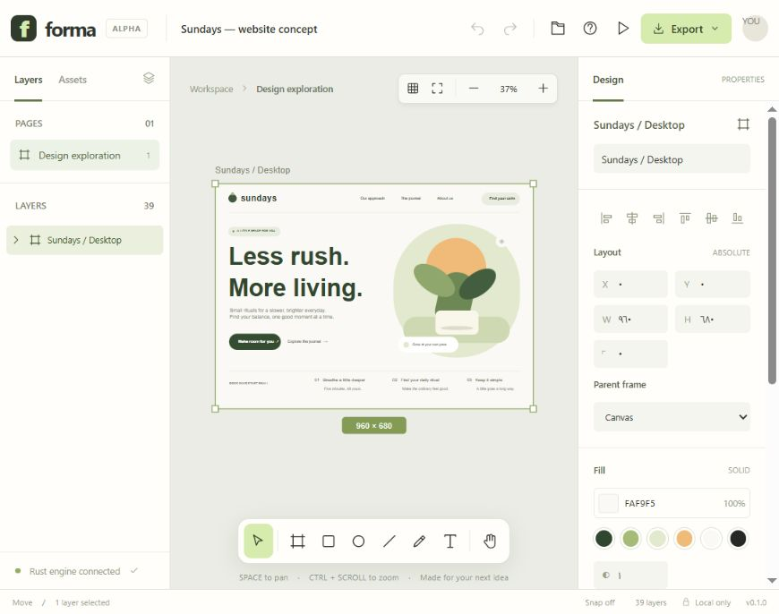

# Forma

**An open canvas for your next idea.**

Forma is an independent, local-first vector design editor with a **Rust / WebAssembly scene engine** and a lightweight TypeScript interface. Draw UI concepts, organize frames and layers, edit typography, and take your work with you as SVG, PNG, or an editable `.forma` document.

[Try Forma](https://ibrahimfmustafa.github.io/forma/) · [العربية](README.ar.md) · [Architecture](docs/ARCHITECTURE.md) · [Roadmap](docs/ROADMAP.md) · [Contributing](CONTRIBUTING.md)



> **v0.1 alpha:** a working single-user editor and a foundation for an open-source Figma alternative. It does **not** claim feature parity with Figma. No proprietary source, assets, file parser, or protocol was copied or decompiled. See [implementation approach](docs/APPROACH.md).

## Run it

Requires **Node.js 22.12+** (24 LTS recommended).

```sh
git clone https://github.com/ibrahimFmustafa/forma.git
cd forma
npm ci
npm run dev
```

Open the URL printed by Vite, usually `http://127.0.0.1:5173`. A compiled Rust engine is included in `public/forma_core.wasm`, so trying the app does not require a Rust installation. All artwork in the sample document is editable.

An editable sample and a vector export are also included in [`examples/`](examples/).

To rebuild the engine from source, install [Rust](https://www.rust-lang.org/tools/install), then:

```sh
rustup target add wasm32-unknown-unknown
npm run build:engine
npm test
npm run build
npm run preview
```

The engine uses stable Rust with no third-party crates. CI rebuilds it from source before running tests. The production build is a static `dist/` folder: host it on any HTTP server, including a subdirectory. GitHub Pages deployment is included.

## What works today

- Infinite canvas with pan, zoom, fit-to-document and fit-to-selection.
- Rectangles, ellipses, multiline text, frames, lines and freehand drawing.
- Nested frame hierarchy, parent assignment, hide/lock, and sibling stacking order.
- Shift selection, marquee selection, move, corner resize, shape rotation, and keyboard nudging.
- Numeric position/size, solid fills, stroke, radius, opacity, and font size/weight.
- Alignment to a selection or containing frame; optional 8 px snapping.
- Rust-owned transactional undo/redo, including whole drag gestures and file imports.
- Duplicate, internal copy/paste, and editable button/card/device templates.
- Automatic browser-local saving, `.forma` save/open, SVG export, and PNG export at up to 2×.
- Artwork preview, keyboard shortcuts, and an original sample design.

## Keyboard

| Action | Shortcut |
| --- | --- |
| Move / frame / rectangle / ellipse | V / F / R / O |
| Text / line / freehand / hand | T / L / P / H |
| Pan / zoom | Space + drag / Ctrl or Cmd + wheel |
| Multiple selection | Shift + click or drag a marquee |
| Undo / redo | Ctrl or Cmd + Z / Shift + Z |
| Duplicate / copy / paste | Ctrl or Cmd + D / C / V |
| Save / open | Ctrl or Cmd + S / O |
| Fit document / selection | Shift + 1 / 2 |
| Nudge / large nudge | Arrow / Shift + Arrow |
| Delete / cancel | Delete / Esc |

Double-click text to edit its content in the inspector. Hold Shift while drawing to constrain proportions. Corner handles scale an unrotated selection, including its descendants. Numeric frame width/height changes the frame boundary without scaling children.

## Your files and privacy

No account, application backend, analytics, external fonts, or runtime CDN dependencies. Project data stays in this browser unless you explicitly download/share it. Hosting providers still receive normal page requests. Autosave is **one document per browser origin**, not a backup: export `.forma` files before clearing browser data or switching devices. New/open operations are undoable within the current session; history is not persisted after reload. The clipboard is internal to the app.

Imports are validated before changing the current document. Limits: 2,000 layers, 16,000 characters per text/path, 8 MB per imported file, and 80 history entries. PNG exports are limited to 8,192 px on either side and 24 megapixels. The app is intended for desktop pointer/keyboard use; on narrower screens the inspector is hidden.

## Current limitations

No live multiplayer, `.fig` import, linked components, auto layout/constraints, boolean vector operations, Bézier node editing, raster image import, custom fonts, prototype links, or multiple pages. Frames use absolute coordinates, have no clipping, and cannot rotate as containers. Text is manually sized and broken into lines; it does not wrap automatically. Freehand hit testing uses its bounds. Performance at the maximum layer count is not benchmarked. This alpha is not a production replacement for large team workflows.

## Development checks

```sh
npm test                    # Real WebAssembly engine + document/import/export tests
npm run build               # TypeScript checking and production build
cargo test --manifest-path engine/Cargo.toml
cargo fmt --manifest-path engine/Cargo.toml --check
```

Native Rust tests require the normal native compiler/linker for your platform. The Node tests execute the actual compiled WASM binary and work without a native Rust linker. See [validation notes](docs/TESTING.md) for the manual browser checklist.

## License

[MIT](LICENSE). Forma and its sample artwork are original. Figma is a trademark of its respective owner; this project is independent and unaffiliated.
